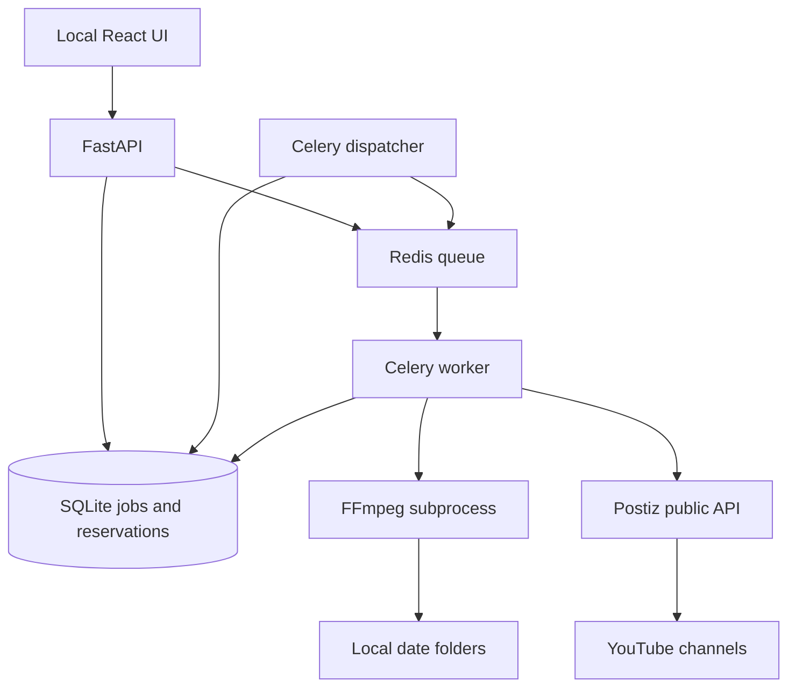

# Local implementation

The browser talks to the local FastAPI server. Planning probes source media, expands the title template, checks Postiz's calendar and reserves slots in SQLite. Starting a batch stores durable state before sending its ID to Celery through Redis. A periodic dispatcher recovers jobs that were saved while Redis was unavailable.

The Celery worker holds a per-job OS file lock. It validates the source snapshot and output folder, invokes FFmpeg, validates the output and stores a checksum. It then uploads the clip bytes to Postiz, stores the returned media reference and creates one scheduled post per destination. Every external post ID is recorded before moving to the next post. SQLite is authoritative; the output manifest is an atomic export for inspection.

## Failure semantics

Queue delivery is at-least-once. File locks and saved clip/publication state prevent simultaneous duplicate local processing. Remote Postiz creation is not claimed to be exactly-once: a timeout after acceptance has an unknown result. That state deliberately stops automatic retries and requires linking the actual remote post. API reads and uploads may retry transient failures; a duplicate orphan upload is preferable to a duplicate public post.

The per-channel slot index prevents collisions among this app's batches. Remote calendars are checked again before submission, but a separate client may still race. Postiz remains the owner of scheduled publication, OAuth refresh and platform delivery errors.

## Local scope

One trusted operator, one Postiz workspace, multiple YouTube channel destinations, one local worker. The UI uses common daily posting times for selected channels; the API data model supports individual channel times. Native local paths are meaningful only to this worker. The server binds loopback, uses a password session and checks media-root containment. It is not an internet-facing multi-tenant service.

## Later hosted version

Preserve the Postiz adapter and state transitions. Add Postgres, durable object storage, user/workspace authorization, encrypted per-workspace credentials, quotas and job ownership. If encoding remains on each user's machine, introduce an authenticated local agent with outbound job polling and scoped upload grants; do not expose arbitrary local filesystem paths to a hosted API. Run Celery and FFmpeg on persistent machines, separate from any frontend hosting platform. Add an Instagram-specific adapter and live acceptance suite before enabling that provider.
